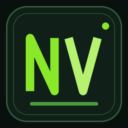

# NV Green Dark

NV Green Dark is a VS Code theme extension with a near-black editor, layered black workbench surfaces, and vivid green accents inspired by `20261020_Task_Progress_Reports`.

## Features

- Color theme for the workbench, editor, terminal, syntax highlighting, and semantic tokens.
- Static Matrix-inspired colors emphasize focus, selections, and active controls without animating the editor.
- File icons for common code, configuration, documentation, firmware image, and log files. Other files use a generic icon.
- Product icons for common workbench actions. Icons without overrides retain the VS Code defaults.
- `NV Green Dark: Apply Complete Theme` command to set all three themes in user settings.

## Local installation

1. Run `npm.cmd install`, `npm.cmd test`, and `npm.cmd run package:verify`.
2. Run `code.cmd --install-extension release/nv-green-dark-0.1.1.vsix`.
3. Run `NV Green Dark: Apply Complete Theme` from the VS Code Command Palette.

The command changes theme settings only when you run it. Webviews that define their own styles may not follow the color theme.

## Icons and maintenance

The SVG files and product icon font were created for this project. Generate the product icon font with `tool/build_product_font.py`; this requires `fonttools==4.60.1`. Generate a visual preview with `tool/render_preview.py`; this also requires Pillow.

This repository currently supports local VSIX installation and validation. It has no public Marketplace release workflow.
